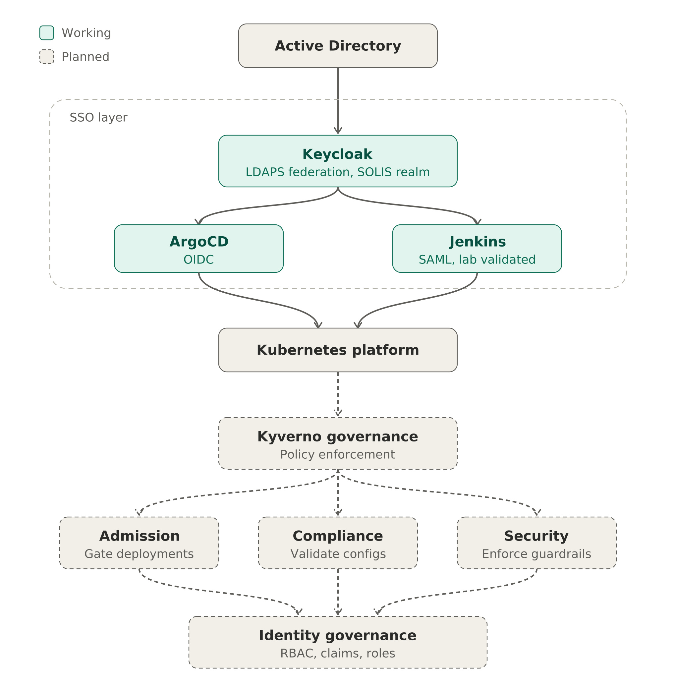
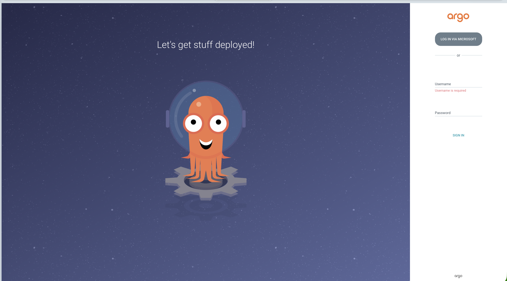
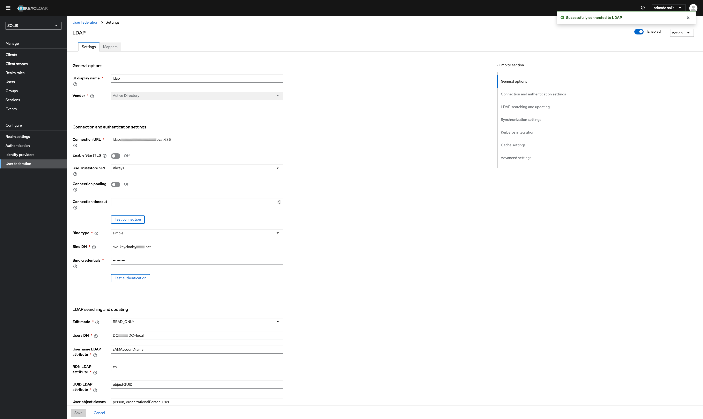
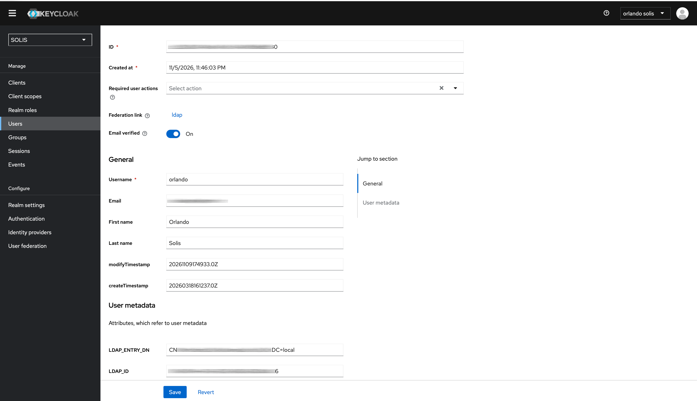
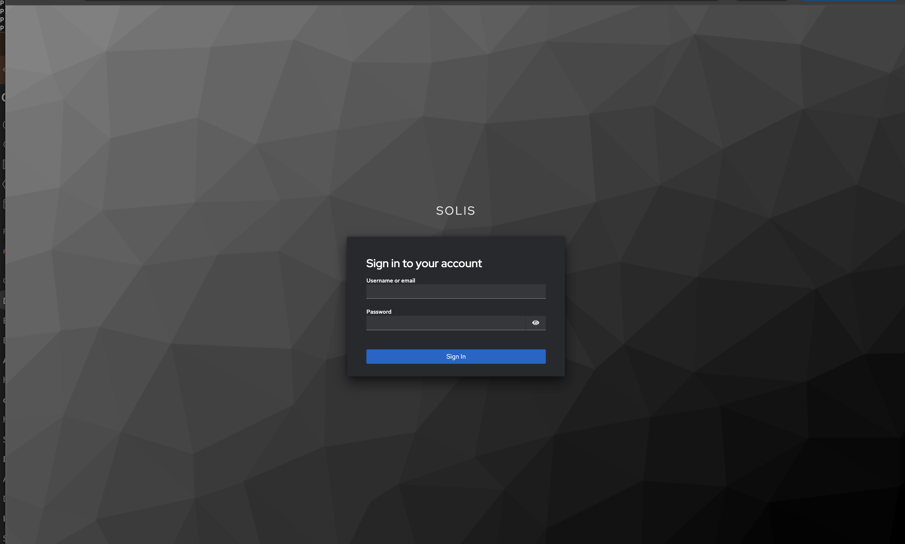
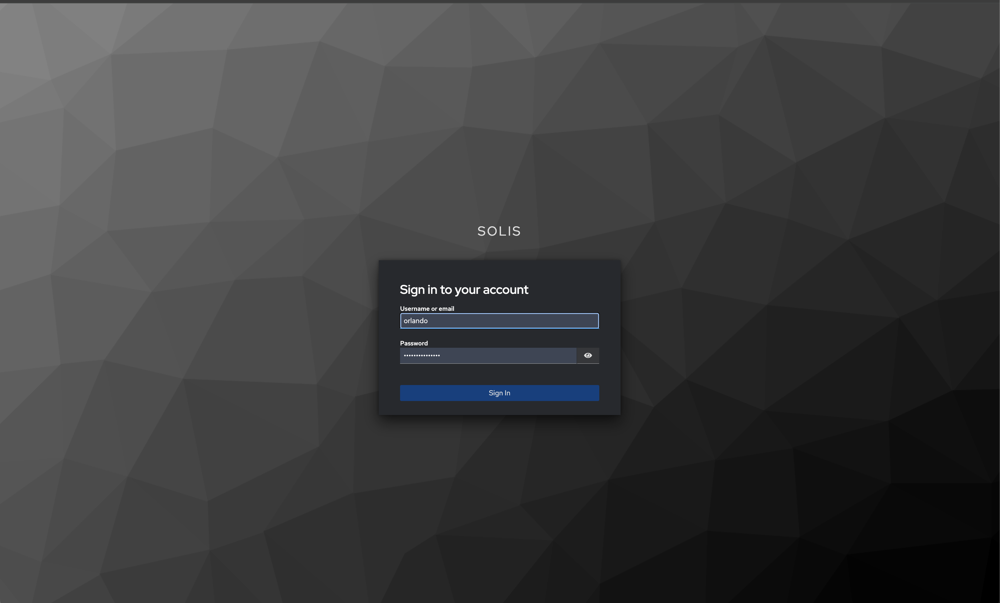
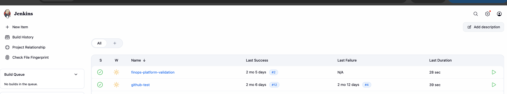
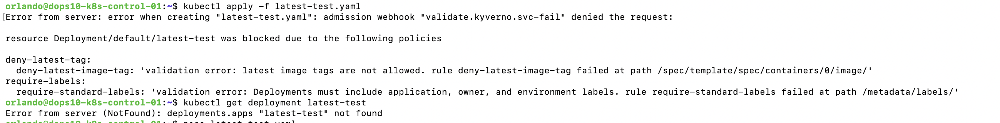

# Dev-Ops-15 Enterprise Identity & Administration Platform



![PowerShell]
![Active Directory]
![Microsoft Entra ID]
![Keycloak]
![LDAP]
![OIDC]
![SAML]
![PostgreSQL]
![Kubernetes]
![Kyverno]

## Overview

Dev-Ops-15 is an Enterprise Identity & Administration Platform designed to automate identity lifecycle management, directory services provisioning, organizational unit assignment, department group assignment, home folder provisioning, access control enforcement, hybrid identity synchronization, identity federation, and modern authentication services.

The platform evolved from a user provisioning script into a centralized identity platform providing automated onboarding, storage integration, hybrid identity synchronization, enterprise identity federation, persistence, certificate trust management, LDAP integration, OIDC, and SAML capabilities.

---

## Portfolio Relationship

Dev-Ops-15 serves as the Identity and Access Management (IAM) platform within the broader Platform Engineering portfolio.

The platform bridges traditional directory services and modern authentication technologies including:

- Microsoft Entra ID
- LDAP
- LDAPS
- OIDC
- SAML
- Keycloak

---

## Project Origin

The project began as a PowerShell-based user provisioning solution.

As additional requirements emerged, the platform expanded to provide:

- Automated onboarding
- Organizational Unit placement
- Department group assignment
- Home folder provisioning
- ACL management
- Hybrid identity integration
- Identity federation
- Single Sign-On services

---

## Objectives

### Completed Objectives

- Automate user creation
- Automate OU assignment
- Automate department group assignment
- Automate home folder creation
- Automate ACL assignment
- Implement operational logging
- Validate drive mappings
- Validate hybrid identity synchronization
- Deploy enterprise identity provider
- Implement LDAP federation
- Implement LDAPS authentication
- Implement user synchronization
- Implement persistent identity services

### Future Objectives

### Future Objectives

- Expand enterprise application integrations
- Implement advanced authorization services
- Expand role-based access control models
- Implement fine-grained authorization policies
- Expand identity governance capabilities
- Integrate governance workflows with Kubernetes policy enforcement
- Evaluate Kubernetes OIDC integration
- Expand policy-driven platform governance

---

## Environment

### Identity Services

- Active Directory
- Microsoft Entra ID
- Keycloak
- LDAP
- LDAPS

### Platform Services

- Kubernetes
- Ingress NGINX
- Kyverno

### Administration Services

- PowerShell
- WinForms

### Storage Services

- SMB
- NTFS Permissions
- Home Directory Services

### Data Services

- PostgreSQL
- Persistent Storage

---

## Technology Stack

### Identity

- Active Directory Domain Services
- Microsoft Entra ID
- Keycloak
- LDAP
- LDAPS

### Automation

- PowerShell
- Windows Forms

### Infrastructure

- Kubernetes
- Ingress NGINX
- PostgreSQL
- SMB CSI Storage
- Kyverno

### Authentication Protocols

- LDAP
- LDAPS
- OIDC
- SAML 2.0

---

## Architecture

### Enterprise Identity Platform

```text
Directory Services Platform
│
├─ DNS
├─ Certificate Services
├─ LDAPS
├─ Users
├─ Groups
│
▼

Enterprise Identity Platform
│
├─ Enterprise Realm
├─ LDAP Federation
├─ User Synchronization
├─ Trust Infrastructure
├─ PostgreSQL Persistence
│
▼

Federated Users

│

├─ OIDC Federation
└─ SAML Federation

        │
        ▼

Enterprise Applications
```

### Identity Flow

```text
User
      ↓
Enterprise Application
      ↓
Identity Provider
      ↓
Directory Services

Authentication
      ↓

OIDC Token
or
SAML Assertion

      ↓

Application Access
```

---

## Implementation

### Phase 1 - Identity Lifecycle Automation

✅ Complete

- WinForms GUI
- User Creation
- OU Assignment
- Group Assignment
- Logging
- Validation

### Phase 2 - Folder & Access Automation

✅ Complete

- Home Folder Creation
- File Server Integration
- ACL Automation
- Drive Validation
- Access Validation

### Phase 3 - Hybrid Identity

✅ Complete

- User Synchronization
- Group Synchronization
- Membership Synchronization
- Cloud Identity Integration

### Phase 4 - Identity Provider Foundation

✅ Complete

- Keycloak Deployment
- Enterprise Realm Configuration
- PostgreSQL Persistence
- Truststore Configuration
- LDAPS Authentication
- LDAP Federation
- User Synchronization
- Administrative Access
- Imported User Validation

### Phase 5 - Application Federation

✅ Complete

Validated:

- LDAP Federation
- User Synchronization
- OIDC Federation
- SAML Federation
- Application Authentication
- Federated User Access

Deliverables:

- ArgoCD OIDC Validation
- Jenkins SAML Validation
- Enterprise Authentication Flows

### Phase 6 - Enterprise SSO

✅ Complete

Validated:

- ArgoCD OIDC Authentication
- Jenkins SAML Authentication
- Federated User Authentication
- Production Authentication Validation
- Enterprise Single Sign-On

Result:

Users successfully authenticate through centralized identity services across multiple applications.

---

## Validation

### Identity Automation

- User Creation Validation
- OU Placement Validation
- Group Assignment Validation
- Logging Validation

### Access Validation

- Home Folder Provisioning Validation
- ACL Assignment Validation
- Drive Access Validation

### Hybrid Identity Validation

- User Synchronization Validation
- Group Synchronization Validation
- Membership Synchronization Validation

### Identity Provider Validation

- Keycloak Deployment
- PostgreSQL Persistence
- Persistent Storage
- Truststore Configuration
- LDAP Connectivity
- LDAPS Connectivity
- LDAP Authentication
- User Synchronization
- Imported User Validation
- Administrative Access

---

## Current Status

### Platform Status

✅ Complete

Validated:

- Identity Lifecycle Automation
- Folder & Access Automation
- Hybrid Identity
- LDAP Federation
- LDAPS Authentication
- PostgreSQL Persistence
- User Synchronization
- Group Synchronization
- OIDC Federation
- SAML Federation
- Enterprise Single Sign-On
- Identity Governance
- Policy Enforcement

Current State:

The platform is operational and successfully provides identity services, authentication, federation, authorization, governance, and policy enforcement capabilities.

Future enhancements will focus on governance maturity, advanced authorization models, and additional integrations.

---
## Lessons Learned

- Authentication and authorization are separate functions.
- LDAP connectivity does not guarantee successful authentication.
- Hybrid identity validation requires user, group, and membership synchronization.
- Persistence must be validated rather than assumed.
- PKIX failures often indicate trust infrastructure issues.
- Trust validation and hostname validation are independent controls.
- Identity providers depend on multiple platform services operating correctly.
- Federation requires more than network connectivity.

---

## Governance Validation

- Group Synchronization Validation
- Role Mapping Validation
- Role Inheritance Validation
- Authorization Validation
- Policy Enforcement Validation

Result:

✅ Governance Model Operational

✅ Role-Based Authorization Operational

✅ Policy Enforcement Operational

---

## Key Outcomes

- Automated onboarding workflow implemented.
- Home folder provisioning automated.
- Access control assignment automated.
- Hybrid identity synchronization validated.
- Enterprise identity provider established.
- PostgreSQL-backed persistence implemented.
- LDAPS federation operational.
- User synchronization operational.
- Enterprise Single Sign-On implemented and validated.
- Enterprise Single Sign-On successfully validated.
- Governance model implemented through groups, roles, and inheritance.
- Authorization model validated using synchronized directory groups.
- Policy enforcement validated using Kyverno governance controls.
---

1. Expand enterprise application integrations.
2. Implement advanced authorization services.
3. Expand role-based access control models.
4. Implement fine-grained authorization policies.
5. Expand identity governance capabilities.
6. Integrate governance workflows with Kubernetes policy enforcement.
7. Evaluate Kubernetes OIDC integration.
8. Expand policy-driven platform governance.

---

## Repository Structure

```text
docs/
diagrams/
kubernetes/
scripts/
screenshots/
examples/
```

---

## Screenshots

### ArgoCD OIDC Login


ArgoCD authentication portal demonstrating OpenID Connect integration through Microsoft Entra ID.

### LDAP Federation


LDAP federation configuration demonstrating secure LDAPS integration between Active Directory and the enterprise identity platform.

### Imported User Federation


LDAP-federated user synchronized from Active Directory into the enterprise identity platform.

### Keycloak Login Page


Custom Keycloak authentication portal providing centralized identity services and enterprise single sign-on.

### Keycloak Authentication Flow


User authentication workflow through the SOLIS identity provider prior to federated access to enterprise applications.

### Jenkins SAML Dashboard


Production Jenkins dashboard accessed through successful SAML federation with Keycloak.

### Kyverno Deny Policy


Kyverno admission controller blocking deployment creation due to governance policy violations, including prohibited image tags and missing required governance labels.
